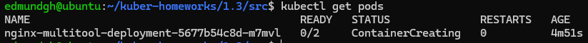
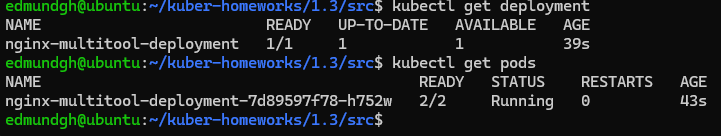
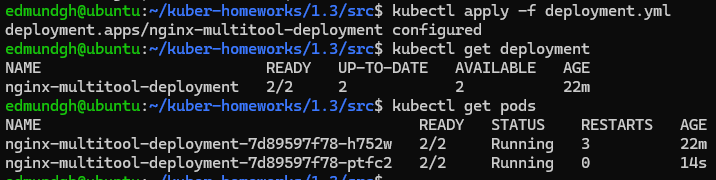
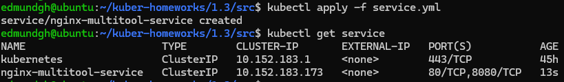
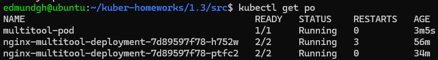
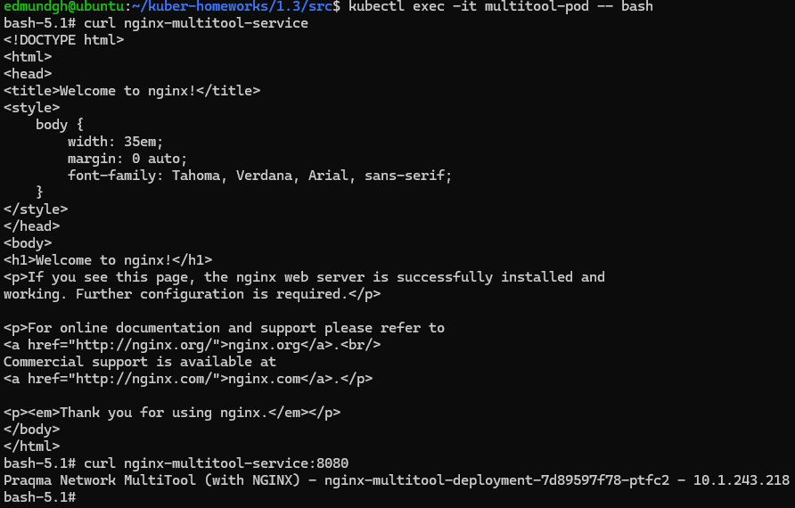
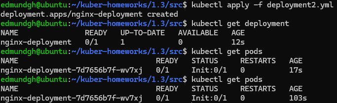
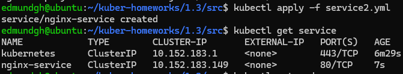
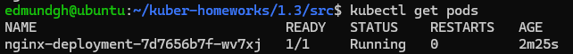

# Домашнее задание к занятию «Запуск приложений в K8S» - Максим Клочек

### Цель задания

В тестовой среде для работы с Kubernetes, установленной в предыдущем ДЗ, необходимо развернуть Deployment с приложением, состоящим из нескольких контейнеров, и масштабировать его.

------

### Чеклист готовности к домашнему заданию

1. Установленное k8s-решение (например, MicroK8S).
2. Установленный локальный kubectl.
3. Редактор YAML-файлов с подключённым git-репозиторием.

------

### Инструменты и дополнительные материалы, которые пригодятся для выполнения задания

1. [Описание](https://kubernetes.io/docs/concepts/workloads/controllers/deployment/) Deployment и примеры манифестов.
2. [Описание](https://kubernetes.io/docs/concepts/workloads/pods/init-containers/) Init-контейнеров.
3. [Описание](https://github.com/wbitt/Network-MultiTool) Multitool.

------

### Задание 1. Создать Deployment и обеспечить доступ к репликам приложения из другого Pod

1. Создать Deployment приложения, состоящего из двух контейнеров — nginx и multitool. Решить возникшую ошибку.
2. После запуска увеличить количество реплик работающего приложения до 2.
3. Продемонстрировать количество подов до и после масштабирования.
4. Создать Service, который обеспечит доступ до реплик приложений из п.1.
5. Создать отдельный Pod с приложением multitool и убедиться с помощью `curl`, что из пода есть доступ до приложений из п.1.

------

## Решение 1

- Манифест деплоймента для nginx и multitool в файле [src/deployment.yml](src/deployment.yml)
- Ошибка возникает из-за работы контейнеров на поту 80, по этому у multitool порт поменян на 8080
- Результат запуска с ошибкой

        
- Результат запуска без ошибки

        
- Работа после увеличения реплик до 2   `replicas: 2`. Видно что количество подов увеличилось.
  
    
- Манифест сервиса в файле [src/service.yml](src/service.yml)
- Запуск и работа сервиса
  
    
- Манифест пода для multitool в файле [src/pod_multi.yml](src/pod_multi.yml)
- Проверка что под запустился

    

- Проверка из пода доступности nginx и multitool через сервис 

    

---

### Задание 2. Создать Deployment и обеспечить старт основного контейнера при выполнении условий

1. Создать Deployment приложения nginx и обеспечить старт контейнера только после того, как будет запущен сервис этого приложения.
2. Убедиться, что nginx не стартует. В качестве Init-контейнера взять busybox.
3. Создать и запустить Service. Убедиться, что Init запустился.
4. Продемонстрировать состояние пода до и после запуска сервиса.

------

## Решение 2

- Манифест деплоймента для nginx в файле [src/deployment2.yml](src/deployment2.yml)
- Ожидание запуска реализуется через `initContainers`, задача которого ожидать получения DNS имени
- Результат запуска 
  
    
- Манифест сервиса в файле [src/service2.yml](src/service2.yml)
- Запуск сервиса

    
- Результат после запуска сервиса. Видно под запустился

    

---

### Правила приема работы

1. Домашняя работа оформляется в своем Git-репозитории в файле README.md. Выполненное домашнее задание пришлите ссылкой на .md-файл в вашем репозитории.
2. Файл README.md должен содержать скриншоты вывода необходимых команд `kubectl` и скриншоты результатов.
3. Репозиторий должен содержать файлы манифестов и ссылки на них в файле README.md.

------