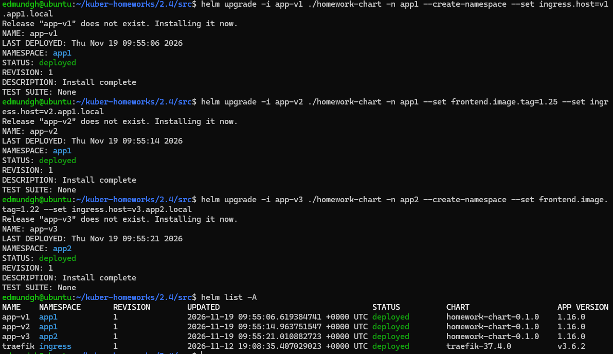
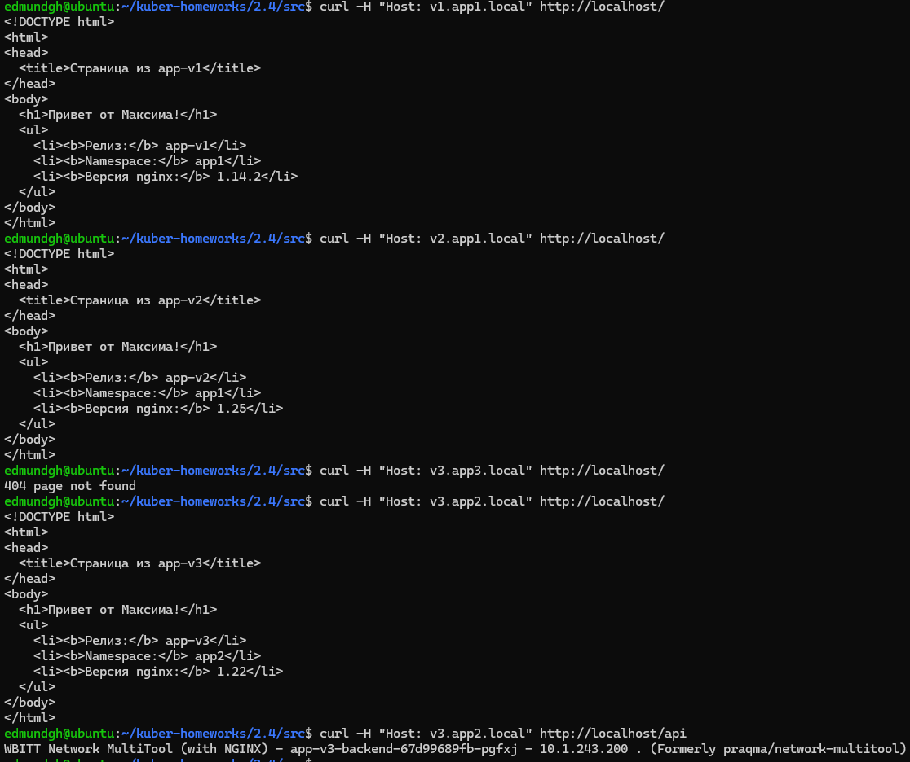

# Домашнее задание к занятию «Helm» - Максим Клочек

### Цель задания

В тестовой среде Kubernetes необходимо установить и обновить приложения с помощью Helm.

------

### Чеклист готовности к домашнему заданию

1. Установленное k8s-решение, например, MicroK8S.
2. Установленный локальный kubectl.
3. Установленный локальный Helm.
4. Редактор YAML-файлов с подключенным репозиторием GitHub.

------

### Инструменты и дополнительные материалы, которые пригодятся для выполнения задания

1. [Инструкция](https://helm.sh/docs/intro/install/) по установке Helm. [Helm completion](https://helm.sh/docs/helm/helm_completion/).

------

### Задание 1. Подготовить Helm-чарт для приложения

1. Необходимо упаковать приложение в чарт для деплоя в разные окружения. 
2. Каждый компонент приложения деплоится отдельным deployment’ом или statefulset’ом.
3. В переменных чарта измените образ приложения для изменения версии.

---
## Решение 1

- Упаковывать буду приложения из занятия 1.4 Сетевое взаимодействие в Kubernetes
- Манифесты шаблонов (фронтэнд - nginx, бекэнд - multitool)
    - [backend-deployment.yaml](src/homework-chart/templates/backend-deployment.yaml)
    - [backend-service.yaml](src/homework-chart/templates/backend-service.yaml)
    - [frontend-configmap.yaml](src/homework-chart/templates/frontend-configmap.yaml)
    - [frontend-deployment.yaml](src/homework-chart/templates/frontend-deployment.yaml)
    - [frontend-service.yaml](src/homework-chart/templates/frontend-service.yaml)
    - [ingress.yaml](src/homework-chart/templates/ingress.yaml)
- Переменные чарта
    - [values.yaml](src/homework-chart/values.yaml)
- Изменении версии приложения в переменной tag в values.yaml

```yaml
frontend:
  replicas: 1
  image:
    repository: nginx
    tag: "1.14.2"
```
- Изменении версии приложения при развертывании флагом `--set frontend.image.tag=1.25`

------
### Задание 2. Запустить две версии в разных неймспейсах

1. Подготовив чарт, необходимо его проверить. Запуститe несколько копий приложения.
2. Одну версию в namespace=app1, вторую версию в том же неймспейсе, третью версию в namespace=app2.
3. Продемонстрируйте результат.

---
## Решение 2

- Запуск командами
```sh
helm upgrade -i app-v1 ./homework-chart -n app1 --create-namespace --set ingress.host=v1.app1.local
helm upgrade -i app-v2 ./homework-chart -n app1 --set frontend.image.tag=1.25 --set ingress.host=v2.app1.local
helm upgrade -i app-v3 ./homework-chart -n app2 --create-namespace --set frontend.image.tag=1.22 --set ingress.host=v3.app2.local
```
- Скриншот успешного запуска

    
- Результат запросов curl `curl -H "Host: v1.app1.local" http://localhost/`
  
     

---

### Правила приёма работы

1. Домашняя работа оформляется в своём Git репозитории в файле README.md. Выполненное домашнее задание пришлите ссылкой на .md-файл в вашем репозитории.
2. Файл README.md должен содержать скриншоты вывода необходимых команд `kubectl`, `helm`, а также скриншоты результатов.
3. Репозиторий должен содержать тексты манифестов или ссылки на них в файле README.md.
